

<picture><source media="(prefers-color-scheme: dark)" srcset="assets/hero-dark.svg"></picture>

<picture><source media="(prefers-color-scheme: dark)" srcset="assets/about-dark.svg"></picture>

<a href="https://github.com/Clash-Projects/LastWave-Native"><picture><source media="(prefers-color-scheme: dark)" srcset="assets/project-lastwave-native-dark.svg"></picture></a>&nbsp;<a href="https://github.com/duxtami/SleepTracker"><picture><source media="(prefers-color-scheme: dark)" srcset="assets/project-sleeptracker-dark.svg"></picture></a>

<a href="https://github.com/duxtami/Sernheise"><picture><source media="(prefers-color-scheme: dark)" srcset="assets/project-sernheise-dark.svg"></picture></a>&nbsp;<a href="https://github.com/duxtami/LastTrack"><picture><source media="(prefers-color-scheme: dark)" srcset="assets/project-lasttrack-dark.svg"></picture></a>

<a href="https://github.com/duxtami/Zurutial"><picture><source media="(prefers-color-scheme: dark)" srcset="assets/project-zurutial-dark.svg"></picture></a>&nbsp;<a href="https://github.com/duxtami/Gramly"><picture><source media="(prefers-color-scheme: dark)" srcset="assets/project-gramly-dark.svg"></picture></a>

<picture><source media="(prefers-color-scheme: dark)" srcset="assets/stack-dark.svg"></picture>

<picture><source media="(prefers-color-scheme: dark)" srcset="assets/stats-dark.svg"></picture>

<picture><source media="(prefers-color-scheme: dark)" srcset="assets/streak-dark.svg"></picture>

<picture><source media="(prefers-color-scheme: dark)" srcset="assets/wave-dark.svg"></picture>

<a href="https://metawka.github.io/expressive-profile/?from=duxtami"><picture><source media="(prefers-color-scheme: dark)" srcset="assets/credit-dark.svg"></picture></a>

